# MD Viewer 使用手册

适用版本：MD Viewer v2.9.0 开发版（尚未发布）。已发布版本未必包含本文新增能力，具体以安装版本和应用内实际界面为准。

本文档面向日常使用 MD Viewer 的用户，说明如何安装、浏览 Markdown、编辑文档、渲染图表以及导出文件。

v2.5.0 重点增加命令行与自动化能力，支持外部脚本和 AI Agent 调用 MD Viewer 打开、预检、导出、截图、列出图表和批量回归。

## 1. 快速开始

### MD Viewer 是什么

MD Viewer 是跨平台桌面端 Markdown 预览工具，适合阅读本地知识库、技术文档、会议材料、方案文档和图表密集型 Markdown 文件。它默认以预览为主，同时提供编辑模式、搜索、书签、分屏、图表渲染和 HTML / PDF / DOCX 导出。


### 下载与安装

请从 [GitHub Releases](https://github.com/wj2929/md-viewer/releases/latest) 下载最新版本。

| 系统 | 推荐安装包 | 说明 |
| --- | --- | --- |
| macOS | `dmg` 或 `zip` | 支持 Apple Silicon 和 Intel Mac |
| Windows | `exe` 或 `zip` | 首次运行可能出现 SmartScreen 提示 |
| Linux | `AppImage` 或 `deb` | AppImage 可能需要 FUSE |

Windows 首次运行如果提示“Windows 已保护你的电脑”，点击“更多信息”，再选择“仍要运行”。

Linux AppImage 用户可先赋予执行权限：

```bash
chmod +x MD-Viewer-*.AppImage
./MD-Viewer-*.AppImage
```

### 首次打开异常处理

macOS 首次打开如果提示“已损坏”“无法验证开发者”或“Apple 无法检查其是否包含恶意软件”，通常是未公证开源应用的 Gatekeeper 提示。请先确认应用来自本项目 Release，并已拖入 `/Applications`，再执行：

```bash
APP="/Applications/MD Viewer.app"; if [ -d "$APP" ]; then xattr -dr com.apple.quarantine "$APP" 2>/dev/null || sudo xattr -dr com.apple.quarantine "$APP"; xattr -d com.apple.provenance "$APP" 2>/dev/null || true; else echo "未找到 $APP，请先把 MD Viewer.app 拖到 /Applications"; fi
```

如果仍无法打开，可继续执行：

```bash
APP="/Applications/MD Viewer.app"; xattr -cr "$APP" 2>/dev/null || sudo xattr -cr "$APP"
```

也可以在“系统设置 -> 隐私与安全性”中选择“仍要打开”。

### 常用场景速查

| 我想做什么 | 去哪里看 |
| --- | --- |
| 打开一个 Markdown 文件夹 | [浏览 Markdown 文档](#2-浏览-markdown-文档) |
| 快速找到文件或内容 | [搜索与定位](#3-搜索与定位) |
| 修改 Markdown | [编辑 Markdown](#4-编辑-markdown) |
| 查看或下载图表 | [图表与公式](#5-图表与公式) |
| 导出 PDF 或 Word | [导出文件](#6-导出文件) |
| 用脚本或 AI 调用 MD Viewer | [命令行与自动化](#10-命令行与自动化) |
| 调整阅读窗口 | [阅读与窗口管理](#7-阅读与窗口管理) |
| 朗读长文或睡前定时停止 | [语音朗读](#语音朗读) |
| 查看快捷键 | [快捷键速查](#9-快捷键速查) |
| 排查问题 | [常见问题与故障排查](#12-常见问题与故障排查) |

## 2. 浏览 Markdown 文档

### 打开文件夹

启动后点击“打开文件夹”，选择包含 Markdown 文件的目录。左侧会显示文件树，右侧显示当前 Markdown 预览。

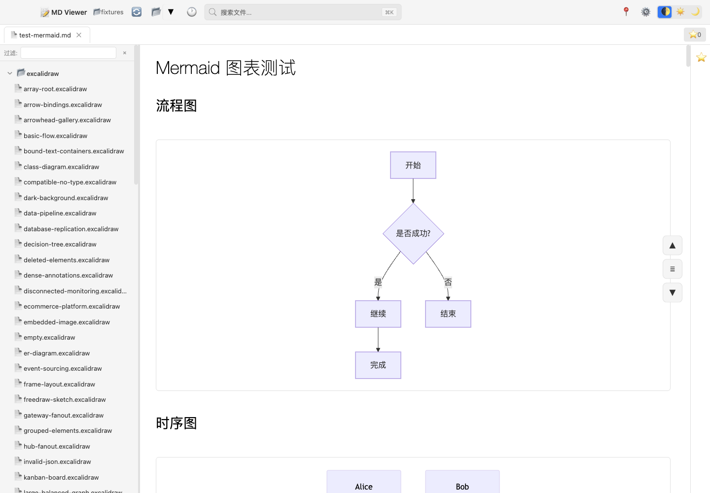

你应该看到左侧文件树、上方标签页和右侧 Markdown 预览区。点击任意 `.md` 文件即可打开。

### 自动刷新与大目录

v2.9.0 把目录和已打开文档的文件监听放在独立进程中。监听初始化或关闭较慢时，不必等待它完成才能继续浏览文件树和阅读文档。状态收进顶部原刷新按钮，不再显示整行横幅：健康时点击直接刷新，其他状态点击后展开说明和操作。

- **中性小圆点**表示生成目录监听受限，点击可查看说明并手动刷新。
- **刷新图标缓慢旋转**表示正在同步变更；点击可查看恢复说明。应用正在重建监听并补查文件树、已加载文档和索引，未加载的标签不会被批量读取。
- **黄色感叹号**表示自动刷新暂不可用，仍可阅读。点击后可选择**刷新内容**，重新检查文件树、已加载文档和当前目录索引；**重试自动刷新**是独立操作，手动刷新不会自动反复重启监听。
- 补查不会覆盖未保存草稿、正在输入或正在保存的内容；磁盘变化会以冲突提示处理。
- 对于父目录直接包含 `.csproj`、`.fsproj` 或 `.vbproj` 的 `bin/obj`，只跳过后台递归监听，不从文件树或搜索中隐藏文档。已打开的文档有精确补充监听；未打开文件可能需要手动刷新。
- 普通文档目录中的 `bin/obj` 不受此规则影响；明确选择生成目录本身作为根目录时也可正常打开。覆盖受限与监听故障会分别提示。

弹层支持 Enter 打开、Escape 关闭并返回刷新按钮，点击外部也会关闭；启用系统减少动态效果后图标不旋转。CLI `watch --jsonl` 的发现规则及输出格式保持不变。

### 大文档预览

v2.9.0 中，超过 150 万字符或 20,000 行的文档会先提示，而不是拒绝打开或截断正文：

- **完整渲染**：继续解析全文；可能占用较多内存并造成界面卡顿，同步渲染期间不保证立即响应取消。
- **查看源码**：只读显示完整文本，不解析 Markdown 或图表。
- 可勾选**记住此文档的完整渲染选择**，选择仅保存在本机；字符数或行数比确认时增加超过 25%，且该项超出默认预算时，会重新提示。最多记住最近 100 篇文档。
- 完整渲染后可点击**恢复大文档提示**，撤销该文档的选择。

默认预算不代表电脑的性能上限；不会按物理内存大小自动放大。现有 5MiB 文件读取上限和图表自身安全限制保持不变。

### 标签页与打开文档管理

每个已打开文档会显示在顶部标签栏。标签过多时，标签栏会隐藏原生横向滚动条，并显示左右滚动按钮；切换文档时，当前标签会尽量自动滚入可见区域。

点击标签栏右侧的“…”可打开“全部打开文档”菜单，用于快速切换到任意已打开文档。菜单中也可以关闭未固定标签；固定标签需要先取消固定后再关闭。

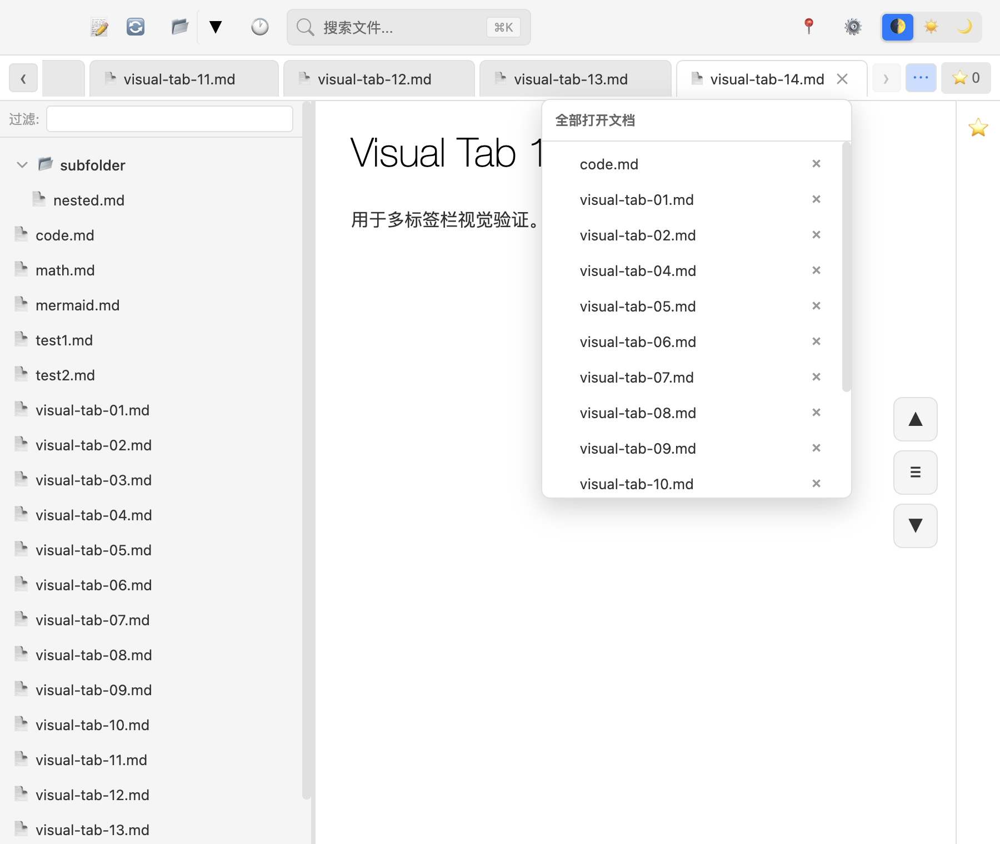

### 文件树、过滤与折叠状态

文件树支持展开、折叠和文件过滤。过滤框可按文件名、相对路径或完整路径匹配文件；清空过滤后会恢复正常文件树。

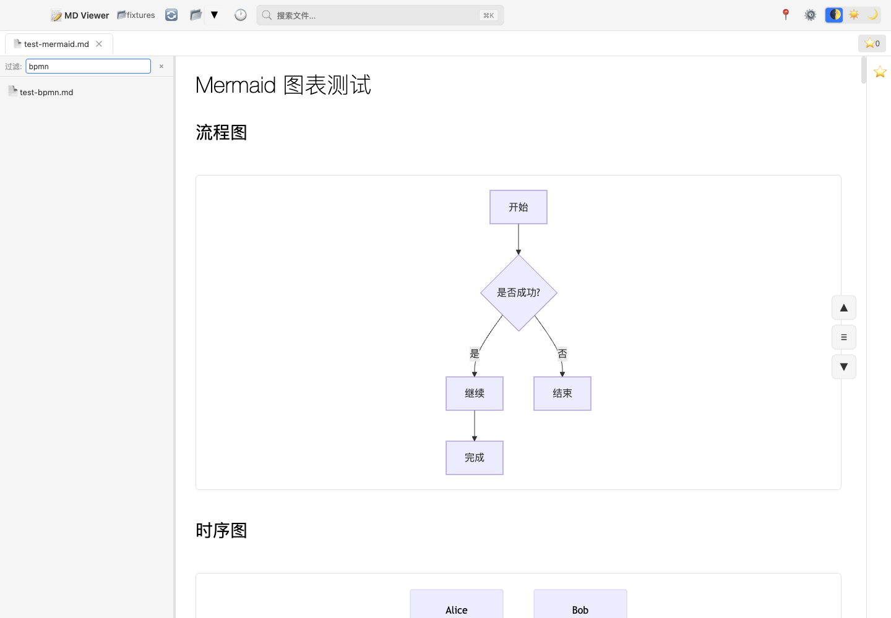

MD Viewer 会按根目录保存文件树折叠状态。重新打开常用目录时，之前整理过的展开和折叠状态会尽量保留。

当目录中 Markdown 文件较多时，将鼠标悬停在某个 Markdown 文件上可打开内容预览卡片，并在卡片底部直接选择一种背景标记色。预览会隐藏文档开头的元数据和围栏代码块，按自然语句显示最多 500 个字符；内容较长时可在卡片正文区域滚动，文件靠近窗口底部时标题和标记栏仍会保持可见。标记只改变文件树中的柔和底色，不修改 Markdown 内容；选择第一个“取消”按钮即可移除。标记会随当前目录保存，同一目录内重命名或移动文件时会继续保留。

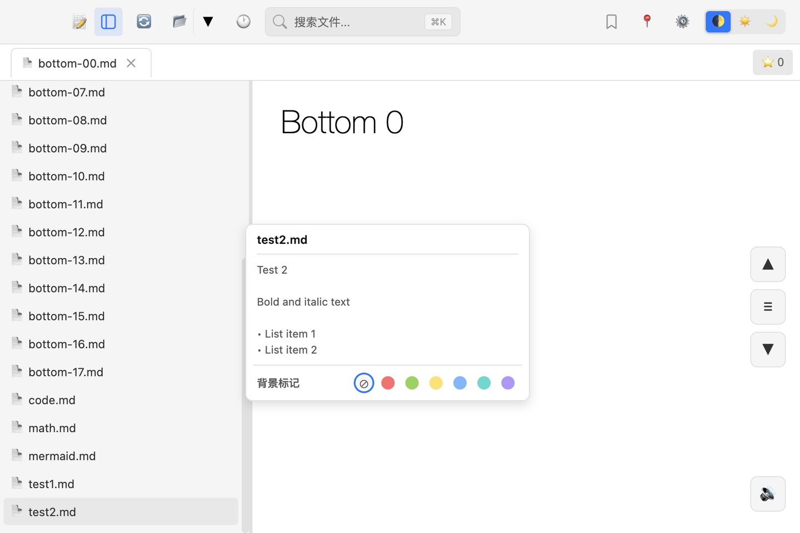

普通打开长文档时，MD Viewer 会尽量恢复最近阅读位置。通过搜索结果打开文档时，以搜索命中位置优先，不会被最近阅读位置覆盖。

### 文件树排序

点击文件树过滤框右侧的排序图标，或进入 **设置 → 浏览 → 目录树排序**。两个入口使用同一份**全局配置**：选择后自动保存，所有目录和窗口同步，重启保留；不是只作用于当前文件夹。

| 排序依据 | 默认方向 | 反向选项 | 含义 |
| --- | --- | --- | --- |
| 名称（现有规则） | 名称升序 | 名称降序 | 沿用原有完整文件名比较，例如 `1.md、10.md、2.md` |
| 名称（自然数字） | 名称升序 | 名称降序 | 数字片段按数值比较，例如 `1.md、2.md、10.md` |
| 文件类型 | 扩展名升序 | 扩展名降序 | 按最后一个扩展名分组，同类型自然名称升序 |
| 修改时间 | 最新在前 | 最早在前 | 文件按自身修改时间；文件夹按所有后代树内文档的最近修改时间 |
| 大小 | 最大在前 | 最小在前 | 文件按自身字节数；文件夹按所有后代树内文档的累计字节数 |

**默认保持原样：文件夹在前，名称升序。** 每层先文件夹组、再文件组，两组分别按选定规则和方向排序，子目录递归应用同样规则，不打平目录。文件类型模式中，文件夹同属目录类型，组内按自然名称及所选方向排列；文件按扩展名排序，同类型文件自然名称升序。中文、大小写和符号依运行环境语言规则比较，与拼音搜索开关无关。自然数字规则从完整名称开头逐段比较，不是按名称末尾日期排序。

文件夹的统计范围是**完整目录树收录的文档**（受支持 Markdown 后缀及 Excalidraw），包含折叠子目录，不随展开状态或名称过滤变化；不统计树外的 CSV、PDF、媒体及隐藏/排除内容。文件夹时间不是文件系统中目录自身的修改时间，大小也不是目录自身的 `stat.size`。名称和类型排序不增加属性读取；仅在时间/大小模式下分批读取文档属性，首次汇总在同步盘或大目录上可能稍慢。

汇总期间保持当前可读顺序，不用部分总量反复重排；文档仍可打开，新增/删除节点照常更新，也可切回名称排序。单个文档无法读取属性时，它与无法完整统计的祖先文件夹分别排到本层各自组的末尾，并提供重试；失败不当作零字节。整批失败不清空目录。文档增删、改名或修改会更新相应祖先的统计，自动监听不可用时可手动刷新。

快捷浮层以“全局”标识范围，保留排序选项、方向及简短规则说明；属性按需读取、同步盘等详细说明保留在设置页。浮层中的“恢复默认”（设置页为“恢复默认排序”）只恢复排序偏好，不重置折叠状态、标记、选中项或会话，也不改文件。排序不影响标签顺序、最近记录、搜索结果或导出顺序；重命名、拖放及 Shift 范围选择期间会暂缓重排，操作结束后应用最新顺序。

### 整理文件：拖动移动与移动到

MD Viewer 提供两种移动文件/文件夹的方式，替代「剪切 → 切目录 → 粘贴」的多步操作：

- **当前目录内拖动移动**：在文件树里直接把文件或文件夹拖到目标目录即可完成移动。拖动进行中，文件树顶部会出现「拖回根目录」投放条，把项目拖到那里即可移回当前根目录。支持多选后整批拖动；拖到自身、其子目录或原目录会被阻止。此方式仅在当前打开的根目录及其子目录内移动。

- **跨目录「移动到…」**：右键文件或文件夹，选择「📦 移动到…」，在弹窗中选择目标。弹窗上半列出你最近打开过的目录，选中某个目录后，下半会逐层展开它的子目录树供你下钻选择目标子目录。确认前会二次提示，弹窗底部实时显示完整目标路径，移动前请核对。此方式可跨目录移动到「最近打开的目录」及其子目录。

两种方式都会在物理移动或重命名前显示链接影响。文件移动与 Markdown 链接修改是两次独立授权：先确认移动，再查看基于移动后最新文件生成的 diff，并单独确认要更新的 exact 链接。修复按文件原子写入、整批 best-effort；revision 已变化的文件会标记冲突且不覆盖，也不提供强制应用。跨根移动只做 origin / moved / target 三侧影响预览，任一侧都不会自动改写链接。目标存在同名文件或目标属于系统敏感目录时，物理操作仍会被拒绝。


### 最近文件、最近文件夹与书签

MD Viewer 会记录最近打开的文件夹和文件，方便快速回到常用文档。你也可以把当前文件或标题加入书签，后续从书签栏或书签面板打开。

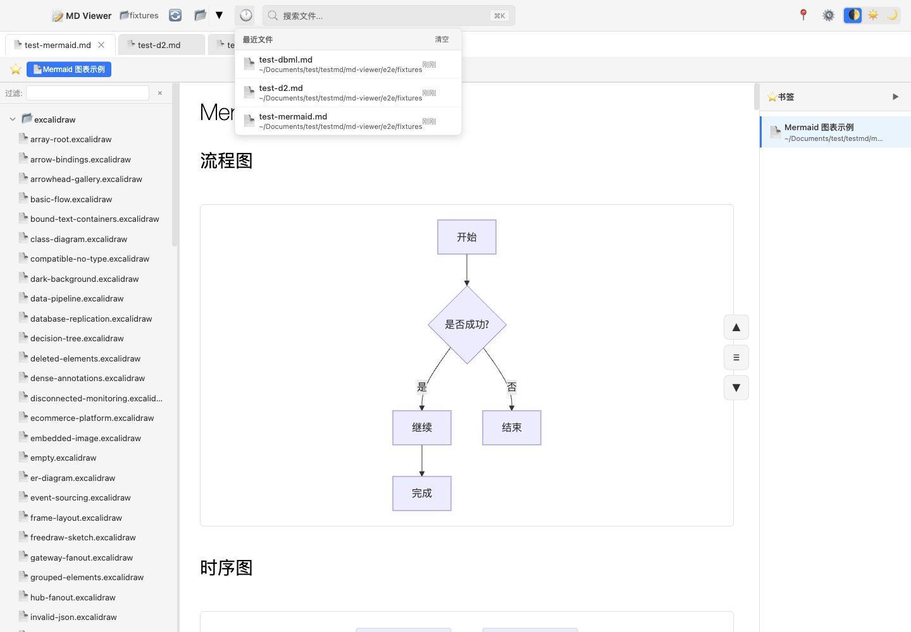

常见入口包括标签页右键、文件树右键和 Markdown 预览区右键。跨文件夹书签会在打开时自动切换到对应目录。

在最近文件、最近文件夹列表上右键，可选择“在新窗口中打开”，在保留当前窗口的同时用独立窗口打开目标文件或目录。

### 最近记录的拼音搜索

最近文件、最近文件夹菜单和“移动到…”弹窗的最近目录搜索，都提供默认关闭的“拼音搜索”开关。启用并保存后，可输入 `yanfa` 查找“研发中心”目录或“研发中心.md”文件；选择在同一应用 profile 内持久保存，三个入口共用已有偏好，其他窗口下次打开搜索界面时读取最新选择。

- 中文/英文字面名称及路径匹配保持优先；最近文件只补充文件名拼音，最近文件夹和移动目录只补充目录名拼音。不匹配共同祖先路径，也不递归搜索目标子目录。
- 名称前缀可输入至少3个字母，允许单个音节或末音节未完成，例如 `yan` / `yanf` 找“研发中心”、`chongq` 找“重庆项目”、`yinh` 找“银行资料”。只从名称开头匹配；`yanf` 不补充“材料研发”，输到 `yanfa` 后可按完整音节匹配。`yf` 等首字母不支持。
- 完整音节匹配仍要求至少4个字母、至少两个相邻汉字，并优先于上述前缀候选；可用空格或英文单引号按音节边界分隔，例如 `YAN FA`、`xi'an`，`lvyou` 与 `lüyou` 均可用。显式分隔错误、不完整内部片段或跨英文/数字/标点的拼接不补充。
- 有原文结果时，“拼音补充”默认折叠；没有原文结果时，“拼音匹配”自动展开。拼音结果先按完整全名、完整名称前缀、完整内部匹配排列，最后是较宽松的名称前缀候选，同层保留历史顺序。
- 拼音默认展示前5项，点击“显示其余…”可访问全部候选；同名文件或目录请核对路径。不枚举多音字备用读音，不提供错拼或模糊搜索；合法音节匹配不代表语义一定相关。
- 关闭开关保留输入和已选移动目标；输入查询本身不会打开文件、切换目录或移动文件。最近文件可在候选项上按 Enter 或空格打开，输入法合成期间不触发打开；Escape 关闭菜单并回到入口。读取/保存失败会提示，未成功保存的选择不保证重启恢复。

### 文件夹标签会话记忆

切换文件夹时，MD Viewer 会记住当前文件夹打开的标签列表和正在阅读的文档；之后切回该文件夹时会自动恢复这些标签与当时的当前文档。重启应用后也会恢复最近打开的文件夹及其标签。

为减少打开大量标签时的内存占用和卡顿，恢复的标签采用懒加载：切回时先重建标签，只有在你点击某个标签（或它进入分屏）时才读取该文档内容，加载期间内容区会显示加载占位。切换文件夹前若当前文档有未保存修改，会先提示是否保存。

文件夹会话还会记住同根分屏结构、分隔比例、活动叶子，以及每个可见叶子的阅读位置。切换文件夹或重新启动后，会优先按仍存在的标题恢复，标题失效时再按滚动比例恢复；由链接或搜索结果发起的显式定位始终优先。多窗口同时打开同一文件夹时，文件夹会话仍按最后写入者覆盖。


### 本地附件与本次来源返回

点击正文的普通本机文件链接或非嵌入的明确文件路径 Wiki 时，应用同时复核请求路径与真实文件类型。合法 `../` 和本机绝对文件路径可以读取尚未打开的目录，不必先打开目标文件夹：

| 类型 | 操作 |
| --- | --- |
| JSON、TXT、LOG、CSV、YAML/YML；SQL、TSV、JSONL/NDJSON | 独立只读文本弹窗；不占 Markdown 标签，不创建草稿或保存文件；SQL 不执行、不连接数据库 |
| INI、CONF、CFG、TOML、properties；XML、HTML/HTM、SVG；常见源码、样式与脚本 | 只读显示源码，HTML/SVG 不渲染网页，脚本不执行；XML、HTML/HTM、SVG 支持标记语法高亮 |
| PDF、DOC/DOCX、ODT、XLS/XLSX、PPT/PPTX、常见图片/音视频（不含 SVG） | 元信息卡片，可精确定位；系统打开仍需原工作区授权与默认取消的原生确认，跨目录单文件读取不授予该资格 |
| 未知或普通无后缀文件 | 先显示文件卡；明确点击“按文本查看”后才尝试严格文本读取；已知二进制、Office、图片/媒体没有未知文本兜底 |
| 缺失、目录、受保护、非法编码/协议/query/fragment、UNC/网络路径 | 明确失败，不提供执行动作；文本附件不支持 query/fragment，Markdown 保留标题锚点 |

自动文本源码/样式后缀：`.js .mjs .cjs .jsx .ts .tsx .py .java .go .rs .c .h .cc .cpp .hpp .cs .kt .swift .rb .php .r .lua .vue .svelte .css .scss .less`；脚本后缀：`.sh .bash .zsh .ps1 .bat .cmd`。既有图片/音视频及特殊图表分流优先，不把 SVG 图片或 BPMN/Excalidraw 嵌入抢成文本。新增文本后缀不能借 symlink 别名获得旧系统打开资格。

文本按 UTF-8 严格读取，支持 BOM、中文和 CRLF；最多5 MiB，不截断或猜测其它编码。超限、无效 UTF-8 或二进制只显示受控元信息。JSON 默认保真排版，原始数字字面量（包括大整数、负零和指数）、重复键、顺序及转义均保留，可随时切回原文。格式化输入超过1 MiB、深度超过64或输出超过2 MiB时显示完整原文；非法JSON也按原文显示，不修改文件。

**JSONL/NDJSON 格式化**：将原文的每个非空行作为独立 JSON 值，默认逐条展开、空行分隔，不合并成数组、不排序或去重；对象、数组及标量记录均可，忽略原始空白行，保留记录顺序、大整数、重复键、负零、指数和字符串转义。展开视图只用于阅读，**不再保持每条记录单行的 JSONL/NDJSON 数据格式**；复制原始数据请切回“原文”，文件本身不会改变。

JSONL/NDJSON 的输入总量最多1 MiB UTF-8、10,000条非空记录，每条嵌套最多64层，全部展开后的输出总量最多2 MiB。任一记录非法时显示其原始行号，任一预算超限时说明原因；两种情况都完整回退原文，不显示部分格式化结果，也不跳过坏记录。支持文件开头BOM、CRLF及末尾换行；不将多行书写的单个JSON误当成JSONL。

SQL、JSON、JSONL/NDJSON、YAML/YML、XML、HTML/HTM/SVG 在预算内默认开启“语法高亮”，可独立关闭；只改变颜色，不执行、校验或修改文件。TXT、LOG、CSV/TSV、普通配置、其他源码及未知格式继续纯文本，不按内容猜测语言。

高亮按**当前显示内容**限制为最多1 MiB UTF-8、20,000行、单行16,384个 UTF-16 字符；任一超限均禁用高亮，完整正文仍可查看、查找和复制。语言按需加载，失败时退回纯文本；关闭再开启可重试。JSON 原文/格式化切换会重新判断预算，与高亮开关互不替代。开关只在当前弹窗有效，不写全局设置。

**SQL 格式化**：默认显示原文，点击“格式化”才在后台排版，可随时切回“原文”。采用标准 SQL 模式、两空格缩进、保留原大小写，不替换参数、不执行或写回文件；支持常见查询、JOIN、CTE、数据操作及部分建表语句，保留受支持的字符串、注释和数值字面量。不进行语法校验，也不保证跨方言语义等价。

SQL 格式化最多处理128 KiB UTF-8输入、10,000个词法token（含空白）及64层嵌套，输出上限256 KiB；Worker等待超过1.5秒、加载失败或任一预算超限均完整显示原文。指数数字、美元引号、反斜杠转义字符串、相邻字符串、嵌套注释、过程体及部分方言操作符等不可靠结构不格式化；这不代表原SQL有语法错误。处理中仍可查看原文、切回原文或关闭；不会因迟到结果重新打开或替换正文。格式化结果仅用于当前弹窗，复制的是当前显示文本；高亮独立按显示内容判断预算。不提供其他格式的通用格式化。

弹窗使用现有 CodeMirror 查找与复制能力：`⌘F / Ctrl+F` 只查附件，`⌘W / Ctrl+W` 优先关闭附件而不关文档标签；Escape先关闭查找，若正文有选区则先折叠选区，再关闭弹窗。`⌘S / Ctrl+S` 不保存附件。原生“窗口→关闭”、`⌘Shift+W`等仍按原窗口关闭和草稿保护处理。关闭弹窗不滚动底层正文，只有原面板和焦点上下文仍有效时才恢复原链接焦点；切工作区或关闭时迟到读取结果不会闪回。

从普通或 Wiki 的跨 Markdown 链接成功进入后，当前阅读面板右侧浮动导航最上方显示`↶`＋“返回”按钮。普通阅读、全文阅读和源码工作台对照预览使用相同位置；分屏各自独立，仅编辑模式没有预览导航时保留工具区“← 返回来源”入口，不在标签栏或分屏头部重复显示。它表示**本次链接的来路**，不同于`⇐`“链接到这里”反向链接统计。悬停可查看完整来源信息及标题锚点/原链接位置；从文件树直接打开或重启恢复的标签没有本次来源，按钮不显示。

- A→B→C 可依次返回 B、A，不追加伪访问，不关闭 B/C 标签；来源标签已关闭时可以重开。来源缺失或读取授权失效时保留当前文档和游标并提示。
- 优先恢复实际点击的同目标第N处链接及视口偏移，引用式/Wiki链接也按正文使用处区分。内容改变时回退到静态标题，再回退阅读比例；动态图表不承诺内部节点精确定位。校正最多1秒/3次，用户主动滚动会停止，不抢其它面板或窗口焦点。
- 大文档返回仍先提示，必须显式完整渲染后才恢复位置，不自动勾选记住。
- 每个窗口、承载工作区及分屏leaf都有独立的有界内存链（最多50节点）；切到另一工作区后切回可恢复，根替换/工作区关闭会清理。单视图首次分屏跟随保留原文档的leaf，关闭/交换面板不合并不同链。
- 手工文件树/搜索等非链接入口成功进入后重新建立无来源根；切换标签只恢复仍有效的本面板访问绑定。链不写设置、localStorage、诊断日志或desktop snapshot，重启不恢复浏览来路；原有最近文件与阅读位置能力不变。
- 新跨未授权目录 Markdown 显示“外部只读 · 临时”，留在原窗口/工作区/面板，可继续 B→C/SQL、关闭来源标签后返回、手动刷新（包括正常修改或同路径 atomic replace）。不编辑、保存、改名、固定、加书签、持久阅读位置或整文档导出；不自动索引/监听目标或授权父目录。
- 同窗口工作区切走再切回保留临时标签并安全重读；重启、根替换、工作区关闭或跨窗口转移不携带临时许可。整工作区转移跳过外部标签但保留根内标签，活动标签和分屏引用随之归一化；请在目标窗口从来源链接重新打开。
- `[[../B.md]]`、`[[C.md]]`、`[[../query.sql]]` 这类明确文件引用走同一点击通道；带目录但无后缀的 Wiki 只尝试五种 Markdown 后缀。裸 `[[名称]]` 保持根内名称查找，外部文档缺少原 owner 时提示使用明确路径，不扫描父目录。
- 单文件许可不开放通用读文件/读目录、搜索、自动图片/音视频/字幕/图表或 `![[资源]]` 嵌入。原有根授权文档能力不变；Windows盘符路径由专用通道处理，设备/ADS、`file://`、UNC/协议相对网络引用拒绝。不能可靠确认文件身份的卷拒绝读取/系统打开。

这是个人本机工具的显式链接读取取舍：主进程不能认证 renderer 中某一次真实点击，opaque ID 也不是用户手势证明；不承诺 renderer 已被攻陷时能阻止其利用有效来源构造其它目标引用。

系统打开只表示交给外部应用，不承诺外部应用只读、无主动行为或系统一定有关联程序；确认等待期间文件/权限改变会拒绝，但无法消除调用后的外部文件系统变化。Finder/文件管理器定位不承诺所有桌面环境都选中目标。普通附件链接未内置查看`.excalidraw/.bpmn`，其原文件树/Wiki图表能力保持不变。

接近5 MiB文本的末尾查找本机曾出现约0.36～0.38秒同步长任务，来自现有CodeMirror逐字符规范化搜索；打开和关闭仍较快，不将此称为全程无卡顿。其它操作系统原生包和外部应用兼容性须分别验证，不能从macOS ARM64结果推断。

### 图片预览与 Lightbox

Markdown 中的图片可以直接预览。点击图片会进入 Lightbox 预览，适合查看大图、截图或设计稿。


Lightbox 中可关闭预览；如果有多张图片，可使用界面按钮或键盘方向键切换。

### 本地媒体与 Wiki 链接

除标准 Markdown 图片和 HTML `` 外，MD Viewer 还支持常用的 Obsidian Wiki 链接及本地图片、音频、视频嵌入。所有资源都必须位于当前 Markdown 所属工作区内，并通过受限的本地资源通道加载；不会把真实绝对路径或 `file://` URL交给预览页面。

| 写法 | 预览行为 |
| --- | --- |
| `[[Note]]`、`[[folder/Note]]` | 打开工作区内的 Markdown 文档，可省略 `.md` 后缀 |
| `[[Note#标题]]`、`[[#当前标题]]` | 打开目标文档并定位标题 |
| `[[Note\|显示名]]` | 使用自定义显示文字 |
| `![[image.png]]` | 嵌入本地图片 |
| `![[image.png\|替代文本]]` | 嵌入图片并设置替代文本 |
| `![[image.png\|100]]`、`![[image.png\|640x480]]` | 使用受限的图片尺寸 |
| `![[video.webm]]`、`![[video.webm\|640x360]]` | 嵌入本地视频，可指定尺寸 |
| `![[audio/song.mp3\|会议录音]]` | 嵌入本地音频，pipe 文本作为标签 |
| `![[diagram.bpmn]]`、`![[board.excalidraw]]` | 复用现有 BPMN / Excalidraw 静态 renderer |
| `![[Note]]`、`![[file.pdf#page=3]]` | 显示可导航的文档或附件卡，不递归展开内容 |

Wiki 文件名仍按源目录、工作区根及根内唯一 basename 查找，存在多个候选时拒绝猜测。普通非嵌入链接仅在文件名明确不存在时，才尝试当前工作区中已保存的 frontmatter 别名；真实文件、已知媒体和附件优先。

**别名示例**：在 `部署手册.md` 的文件开头写入并保存：

```yaml
---
aliases:
  - 运维指南
  - 版本 1.0
---
```

随后可用 `[[运维指南]]` 或 `[[版本 1.0|手册]]` 打开真实文件。`aliases` 接受字符串或字符串数组，去除首尾空白、同文档去重，区分大小写。值不做 URL 解码；路径、片段、Wiki 分隔符及控制字符不作为裸别名。数字、对象、混合数组、自定义标签或 YAML 引用不展开为别名。

别名只来自内容索引与持续监听范围的交集，不额外扫描被忽略目录；未保存的 frontmatter 不生效。每文档头部最多 64 KiB、128 个别名、每项 256 字符；每根最多 100,000 条引用和 32 MiB 别名文本。解析失败、超限、监听缺口或索引更新时会拒绝不可靠的别名判断，不影响明确文件路径阅读，也不建议用重建索引解决错误 YAML。反链会注明结果不完整；移动时仍有效的纯别名保持原文，遮蔽、歧义或不完整关系仅报告候选，不自动改写。

**精确块链接**：`正文 ^rollback` 定义段落块，可用 `[[部署手册#^rollback]]`、`[[#^rollback]]` 或 `[回滚](#^rollback)` 定位。ID 仅接受非空的英文字母、数字和连字符，大小写敏感，重复 ID 会报歧义。

- 段落末行的空白分隔 `^id` 标记该段落；列表中的后缀标记最近列表项，引用中的普通段落后缀不扩大到整个引用。
- 独立 `^id` 可标记同容器中紧邻的段落、完整列表或引用，不跨越其他结构。标题、表格、代码、原始 HTML、数学内容和 frontmatter 不产生块定义。
- 标记保持可见，不会在编辑或保存时偷偷删除。原始 HTML 伪造的保留锚点不能冒充块。
- 同页链接只使用当前已显示的预览，不重新读磁盘；跨页先检查实际将显示的正文，已有未保存草稿优先。缺失或歧义时留在来源；激活后内容变化导致定位失败时明确提示，不假装定位到文首。用户主动滚动会取消后续自动校正。
- 完整渲染器生成的 HTML 支持同页真实块 fragment；不承诺跨文件别名打包、PDF 内部块链接或 DOCX Word 书签。历史“返回来源”的标题/比例恢复策略不变。

原生 HTML 音视频也可以使用相对路径：

```html
<video
  src="videos/demo.webm#t=10,25"
  controls
  poster="images/poster.png"
  style="width: 100%; height: auto;">
  <track
    src="videos/zh.vtt"
    kind="subtitles"
    srclang="zh-CN"
    label="中文"
    default>
</video>

<audio src="audio/meeting.mp3" controls preload="metadata"></audio>
```

每个播放器最多接受 4 个 `<source>` 和 4 个本地 `.vtt` 字幕/说明/章节轨；VTT 必须是 UTF-8、以 `WEBVTT` 开头且不超过 1 MiB。`#t=start,end` 支持非负秒数及常用 NPT 时间写法，到达可选 end 后会暂停。为避免页面自动执行媒体，`autoplay`、事件属性、远程 URL 和任意媒体 CSS 不会被保留。

支持的资源范围：

- 图片：PNG、JPEG、GIF、WebP、SVG、AVIF、BMP；单文件最大 10 MiB。
- 音频：FLAC、M4A、MP3、OGG、WAV、3GP；HTML `<audio>` 还可显式使用 WebM。
- 视频：MKV、MOV、MP4、OGV、WebM。
- 音视频单文件必须非空且不超过 4 GiB。扩展名和容器受到支持不等于当前平台一定具备对应 codec；无法解码时会显示安全降级状态。

导出策略刻意不把大媒体塞进文档：HTML 保留相对于导出文件的 source、track 和 poster 链接，不复制 sidecar，因此单独移动 HTML 后媒体可能失效；PDF 将视频降级为 poster 加说明、音频降级为文字卡；DOCX 使用普通相对链接或说明文字。CLI 解析媒体时以源 Markdown 所在目录为严格根目录，比 GUI 的工作区范围更窄。

当前仍不支持真正的 Markdown 全文、章节或块内容嵌入；`![[...]]` 文档卡片不使用 frontmatter 别名。PDF、Office 或 Canvas 不以内联查看器打开，仍显示安全卡片。

## 3. 搜索与定位

### 全局搜索

全局搜索用于快速打开文件。当前搜索按钮和快捷键帮助中显示为 `Cmd/Ctrl+K`。输入关键词后，MD Viewer 会按文件名、路径和历史记录返回匹配项。

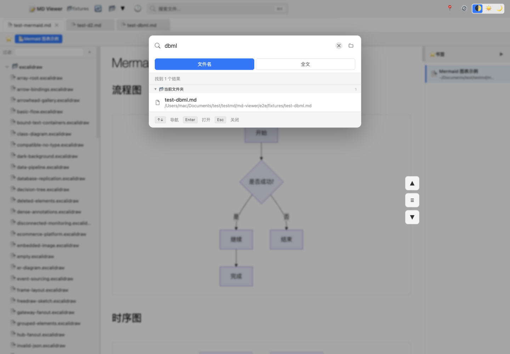

如果当前界面显示的快捷键和本文档不一致，请以当前应用内的快捷键帮助为准。

### 全文搜索

全文搜索用于在当前文件夹内查找文档内容。适合查找某个术语、项目名或会议主题。搜索结果较多时，优先查看文件名、路径和命中片段。

搜索面板会显示当前范围，例如文件名、全文或当前文档。点击全文搜索结果后，MD Viewer 会打开对应文件并滚动到命中行附近，短暂高亮关键词。

全文搜索由主进程的本地工作区索引提供。首次打开文件夹时会在后台建立索引，不阻塞文档阅读；搜索区会显示“索引中 / 就绪 / 部分降级 / 不可用”等状态。索引只保存标题、链接、词频、revision 等分析信息，不保存 Markdown 正文；返回命中前会重新读取并校验候选文件。

大目录、超过 5 MiB 的 Markdown、暂时不可读或解析失败的文件可能让结果不完整，界面会明确显示降级状态，不会静默退回渲染进程读取整个工作区。

### 反向链接

当前文档被其他已索引 Markdown 引用时，右侧浮动导航会显示反向链接入口和数量；没有反向链接且索引已就绪时不显示入口。点击来源可打开对应文档并定位到引用行。索引仍在建立、降级或查询失败时会显示相应状态，不把查询错误误判为零反链。

### 页面内搜索

页面内搜索用于在当前 Markdown 文档里定位内容。当前快捷键帮助中显示为 `Cmd/Ctrl+Shift+F`。搜索框会显示匹配计数，并支持跳到上一个或下一个匹配。

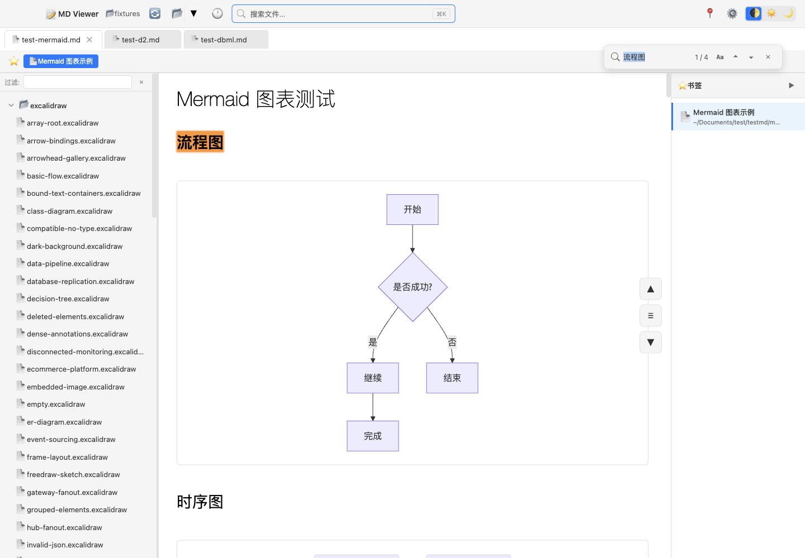

如果搜索不到内容，先确认你使用的是全局搜索、全文搜索还是页面内搜索。三者范围不同。

### 目录导航

文档中存在标题时，MD Viewer 会提供目录导航和当前位置提示。长文档阅读时可以用目录快速跳转到某个章节。

## 4. 编辑 Markdown

### 进入与退出编辑模式

MD Viewer 默认以预览模式打开 Markdown。只有进入编辑模式后，文档内容才可以修改。编辑入口以当前界面显示为准，通常位于当前文档工具区或更多菜单中。

退出编辑模式前，如果存在未保存修改，MD Viewer 会提示你保存或放弃草稿，避免静默丢失内容。

### 源码编辑

源码编辑适合修改 Markdown 语法、图表代码、复杂表格和代码块。编辑器支持 Markdown 高亮、基础格式工具和常用编辑快捷操作。编辑/对照模式的格式工具栏提供“图表”按钮，可直达“设置 → 图表 → 模板库”；此入口会绑定发起操作的文档，选择模板后可直接插入。若期间切换、关闭文档或退出编辑状态，原插入目标会失效，不会改写其他分屏。

### 渲染区直接编辑

进入编辑模式后，渲染区支持常见 Markdown 块直接编辑，包括段落、标题、引用、列表项、表格单元格和普通代码块。图表、嵌入式组件、特殊 HTML 或非标准 Markdown 请优先使用源码编辑。

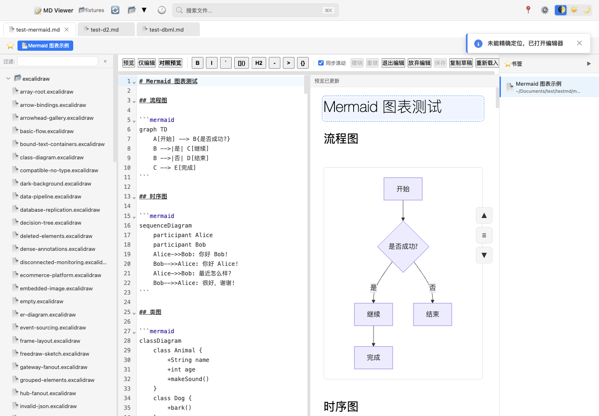

如果某个块无法直接编辑，预览区会显示“在源码中编辑”。点击后会切换到源码编辑并尽量定位到对应行；没有精确行号时，会打开源码并提示需要手动确认位置。提示卡不会参与 HTML/PDF/DOCX 正文导出。

### 对照预览

对照预览适合连续修改文档：左侧编辑 Markdown，右侧实时显示草稿预览。

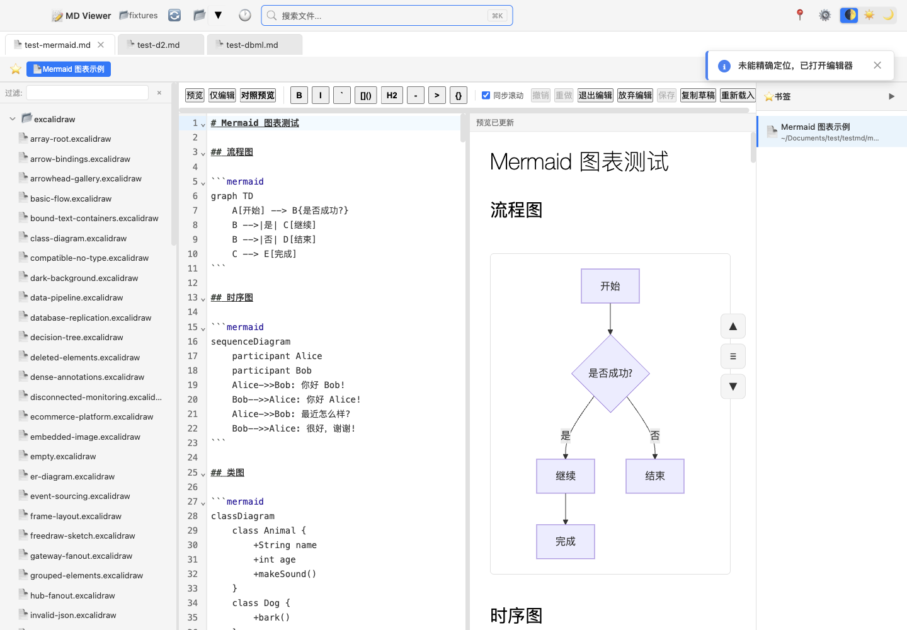

图表密集型文档在实时预览时可能出现短暂“渲染中”。编辑时以输入流畅为优先，预览可能略有延迟。

### 保存、放弃与草稿恢复

编辑后可以保存到磁盘，也可以放弃未保存修改并回到磁盘版本。异常关闭后再次打开同一文档时，MD Viewer 可能提示恢复草稿。

导出前如果存在未保存草稿，应用会要求先保存或取消导出，避免导出内容和你看到的草稿不一致。

### 编辑限制与冲突处理

同一文件在多个分屏面板中打开时，当前版本会尽量避免多个可写编辑器同时修改同一个草稿。外部编辑器修改同一文件时，如果本地存在未保存草稿，MD Viewer 会保留草稿并提示处理冲突。

## 5. 图表与公式

### 从设置发现图表能力

打开“设置 → 图表”后可使用三个子页：

- **模板库**：按用途和运行方式浏览当前支持的 20 类图表与公式，搜索名称、围栏语言或场景；进入详情后可切换真实预览和源码，并直接查看应用预览、HTML、PDF、DOCX 的格式支持。远程类型默认自动生成预览；关闭自动渲染后才显示一次连接确认。
- **离线示例**：一键准备并打开随应用安装的固定 ZIP。内容版本 `2.9.0-r1` 包含 20 类能力的 21 个快速入门模板、129 个设计核心案例和 885 个 renderer 专项正例，共 1,014 个案例；根 README 提供首次成功路径、联网/导出边界和失败排查，分册与 renderer 页面提供选型提示、稳定案例 ID、返回与分页导航。专项案例按数据可视化、架构建模、流程协议、公式知识、Excalidraw 和服务渲染器分册，默认每个 renderer 一个 Markdown，仅对隐藏性能实测超限的重型 renderer 固定分页。
- **渲染服务**：开关联网图表自动渲染，选择 PlantUML 官方或自定义服务、保存并测试地址，并查看 Kroki 等显式远程能力的说明。

欢迎页的“图表与架构图”会直接打开离线示例页。点击“打开离线示例…”后，MD Viewer 会校验并安全准备随应用提供的固定示例包到应用数据目录、将大型分册目录初始化为折叠状态、切换到示例工作区，并自动打开根目录 README；无需选择位置或手工解压。准备失败时设置页和当前工作区保持不变，也不会覆盖内容不同的已有示例。“仅导出 ZIP…”用于分享、备份或手工处理，整个准备与导出过程不访问 GitHub 或其他网络。

PlantUML、C4-PlantUML 和 Kroki 默认连接对应服务并自动渲染，源码会发送到设置页所示 endpoint。若不希望打开文档时联网，可在“渲染服务”关闭“自动渲染联网图表”；此后普通 Markdown 只在文档顶部显示一个确认条，点击一次即放行本篇全部联网图表。同一路径的分屏共享本次会话批准，不同文档分别确认，重启后清除。请求采用共享有限并发和成功缓存；失败时保留当前源码，可手工重试。

### 支持类型总览

| 类型 | 写法 | 典型用途 | 导出说明 |
| --- | --- | --- | --- |
| Mermaid | <code>```mermaid</code> | 流程图、时序图、类图、状态图、甘特图等 | 支持预览和导出 |
| ECharts | <code>```echarts</code> | 交互式统计图、仪表板图表 | 支持预览和导出 |
| Markmap | <code>```markmap</code> | Markdown 思维导图 | 支持预览和导出 |
| Graphviz | <code>```dot</code> / <code>```graphviz</code> | DOT 图、依赖关系图 | 支持预览和导出 |
| PlantUML | <code>```plantuml</code> | UML、C4、时序图、用例图 | 依赖 PlantUML 服务配置 |
| DrawIO | <code>```drawio</code> | diagrams.net 图表 | 预览效果最好，导出依赖已渲染内容 |
| Infographic | <code>```infographic</code> | 信息图 | 支持预览和导出 |
| KaTeX | `$...$` / `\(...\)`（行内），`$$...$$` / `\[...\]`（块级） | 数学公式 | 支持预览和导出 |
| Excalidraw | <code>```excalidraw</code> / `.excalidraw` | 静态画板预览 | 不提供 Excalidraw 编辑 |
| Vega-Lite | <code>```vega-lite</code> | 声明式统计图 | 支持预览和导出 |
| D2 | <code>```d2</code> | 架构图、流程图 | 支持预览和导出 |
| BPMN | <code>```bpmn</code> / `.bpmn` | 业务流程建模 | 支持预览和导出 |
| WaveDrom | <code>```wavedrom</code> | 数字时序图 | 支持预览和导出 |
| C4-PlantUML | <code>```c4</code> / <code>```c4plantuml</code> | C4 架构图 | 支持预览和导出 |
| Structurizr | <code>```structurizr</code> | Structurizr DSL 架构模型 | 支持预览和导出 |
| Plotly | <code>```plotly</code> | 复杂图表、统计图、3D 图表 | 支持预览和导出 |
| DBML | <code>```dbml</code> | 数据库 ERD | 支持预览和导出 |
| AntV G6 | <code>```antv-g6</code> | 关系图、拓扑图、知识图谱 | 支持预览和导出 |
| SVG（受限） | <code>```svg</code> | 自包含静态矢量图、精确布局图 | 仅接受安全静态子集；支持预览和导出 |
| Kroki | <code>```kroki</code> / <code>```nomnoml</code> 等 | 长尾图表格式 | 具体格式和网络策略以当前实现为准 |

Kroki 常见子格式包括 `nomnoml`、`pikchr`、`svgbob`、`bytefield`、`tikz`。PlantUML 或 Kroki 如果依赖远程服务，网络不可用时可能渲染失败。

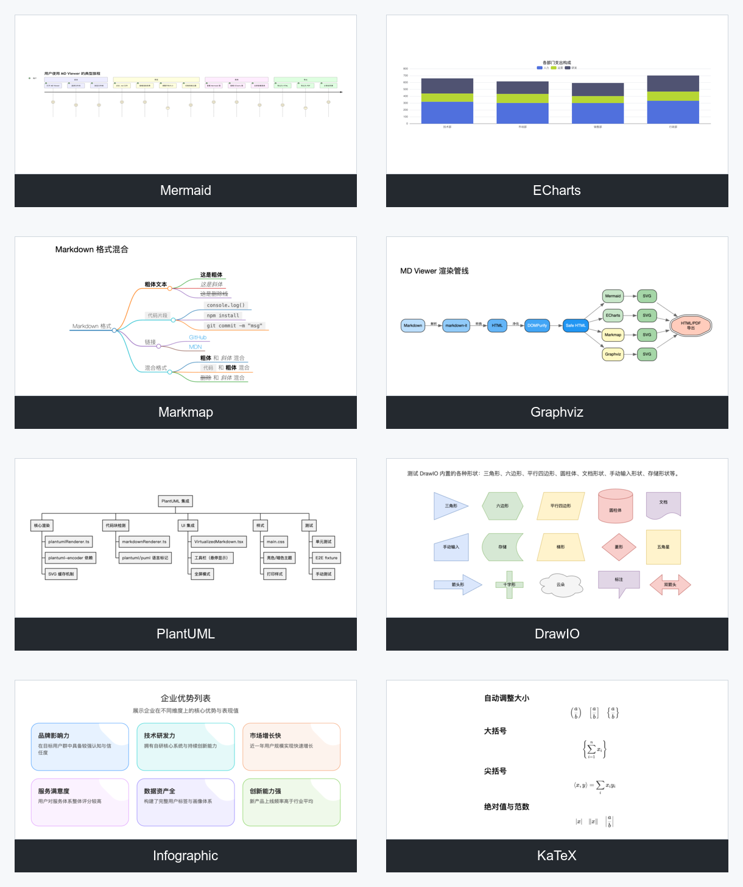

更多图表效果、适用场景和测试样例见 [图表样例库](chart-gallery.md)。

### 图表能力矩阵

下表是面向日常使用的静态能力说明，实际表现仍以当前图表工具栏和导出结果为准。

| 类型 | 预览 | 全屏/缩放 | 源码 | 单图下载 | 批量导出 | HTML/PDF | DOCX |
| --- | --- | --- | --- | --- | --- | --- | --- |
| Mermaid / ECharts / Markmap / Graphviz | 支持 | 支持 | 支持 | 支持 | 支持 | 支持 | 支持 |
| DrawIO / Infographic / Excalidraw | 支持 | 支持 | 支持 | 支持 | 支持 | 支持 | 支持 |
| KaTeX | 支持 | 不适用 | 源码在 Markdown 中 | 不适用 | 不适用 | 支持 | 支持 |
| Vega-Lite / D2 / BPMN / WaveDrom / C4-PlantUML | 支持 | 支持 | 支持 | 支持 | 支持 | 支持 | 支持 |
| Structurizr / Plotly / DBML / AntV G6 / SVG（受限） | 支持 | 支持 | 支持 | 支持 | 支持 | 支持 | 支持 |
| PlantUML / Kroki | 取决于服务或网络 | 支持 | 支持 | 支持 | 支持 | 支持 | 取决于 DOCX 服务和网络 |

如果预览能显示但导出有 warning，请以导出详情中的“影响是什么”和“下一步怎么做”为准。

### 常用图表示例

Mermaid：

````markdown

````

KaTeX：

```markdown
行内公式：$E = mc^2$

块级公式：
$$
\frac{-b \pm \sqrt{b^2 - 4ac}}{2a}
$$
```

也兼容常见的 LaTeX 反斜杠定界符：

```markdown
行内公式：\(E = mc^2\)

块级公式：
\[
\sum_{i=1}^{n} i = \frac{n(n+1)}{2}
\]
```

`\[` 和 `\]` 需要像示例一样各自独占一行，以免把普通 Markdown 的方括号转义误判为公式。若要原样显示 `\(` 或 `\)`，请再加一层反斜杠，例如 `\\(TODO\\)`。

BPMN 文件引用：

````markdown
```bpmn
<?xml version="1.0" encoding="UTF-8"?>
<bpmn:definitions xmlns:bpmn="http://www.omg.org/spec/BPMN/20100524/MODEL">
  <!-- 这里放 BPMN XML 内容 -->
</bpmn:definitions>
```
````

Excalidraw 文件引用：

````markdown
```excalidraw
{
  "type": "excalidraw",
  "version": 2,
  "elements": []
}
```
````

### 图表工具栏

多数图表支持工具栏操作：查看源码、放大、缩小、适应大小、下载图片和全屏查看。

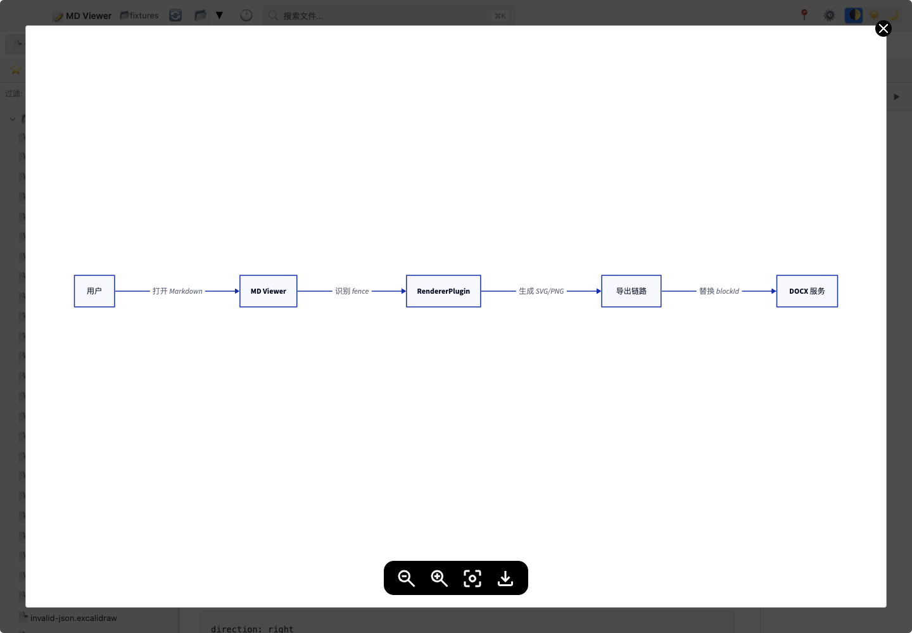

不同图表类型的按钮可能略有差异。以当前图表上显示的工具栏为准。

### 全屏、缩放、源码与下载

图表全屏适合查看大图、架构图和流程图。进入全屏后可以缩放、适应大小或关闭全屏。查看源码用于检查图表语法，下载图片用于把当前图表保存为 PNG。

### 批量打包下载图表

在预览区右键，选择“打包下载图表”。MD Viewer 会把当前文档中可导出的图表保存为 ZIP，解压后图表位于同名文件夹中。

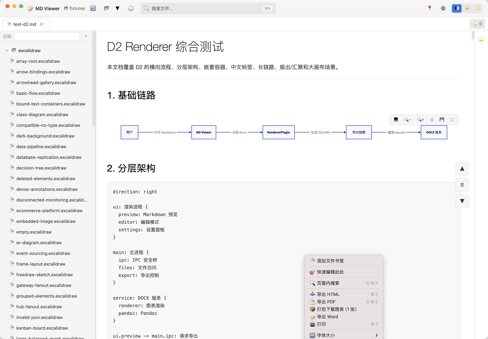

该菜单通常只在当前文档存在可导出图表时显示。如果图表渲染失败，导出结果可能不完整。

### 图表故障排查

图表不显示时，先切换到源码视图检查语法。再确认是否需要外部服务，例如 PlantUML 服务地址、Kroki 网络访问或 DOCX 服务端图表截图能力。

## 6. 导出文件

### 导出 HTML

HTML 适合浏览器打开、离线归档和分享给需要保留 Markdown 样式的人。HTML 导出不需要 DOCX 服务。

导出前如果检测到缺失图片、坏链、外部图表服务或 DOCX 服务不可用，应用会先显示风险摘要，说明“影响是什么”和“下一步怎么做”；干净文档仍会直接导出。


### 导出 PDF

PDF 适合发送、打印和定稿阅读。PDF 导出不需要 DOCX 服务。

普通文档直接完整打印；图表密集的大文档若完整打印失败，会在独立进程中自动按页段重试并合并，保留正文、矢量图表和内部/外部链接，不以固定页数限制文档长度。导出提示会持续到任务实际结束，复杂文档可能需要更长时间。

自动分段要求字体与图片等资源已封存；如果错误提示包含“未封存的外部资源”，请先将资源保存到工作区并改用本地引用后重试。超时、单页仍无法打印或合并校验失败会明确报错，不跳过失败页，也不会用不完整结果替换已有目标文件。关闭发起导出的窗口会取消该窗口的任务。

### 导出 DOCX

DOCX 适合继续用 Word 编辑。高质量 DOCX，尤其是图表密集型文档，建议配置 `md-viewer-docx-service`。

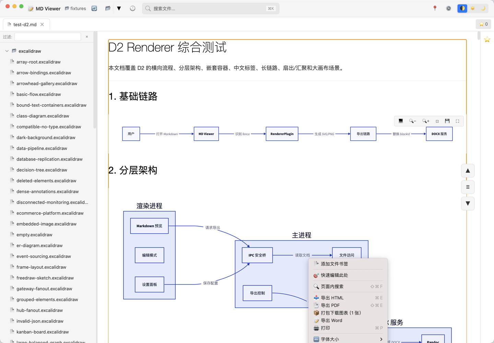

如果只导出 HTML 或 PDF，不需要启动 DOCX 服务。只有需要高质量 DOCX 时，才需要配置 DOCX 服务。

### DOCX 模板样式

DOCX 支持多种模板样式：

| 样式 | 适合场景 |
| --- | --- |
| 预览一致 | 接近 Markdown 预览与 PDF 的页面节奏 |
| 通用 Word | 适合后续编辑的常规 Word 排版 |
| 正式公文 | 政府机关公文（GB/T 9704） |
| 机关内部 | 内部行文、通知 |
| 调研报告 | 研究分析、学术报告 |


如果当前 DOCX 服务不支持某个样式，界面会禁用或在导出时临时回退到可用样式。

### DOCX 服务配置

进入设置面板，切换到“导出”页签，找到“DOCX 导出服务”。启用后填写服务器地址，默认示例通常是 `http://localhost:3179`。如服务配置了 API Key，需要在高级选项里填写。

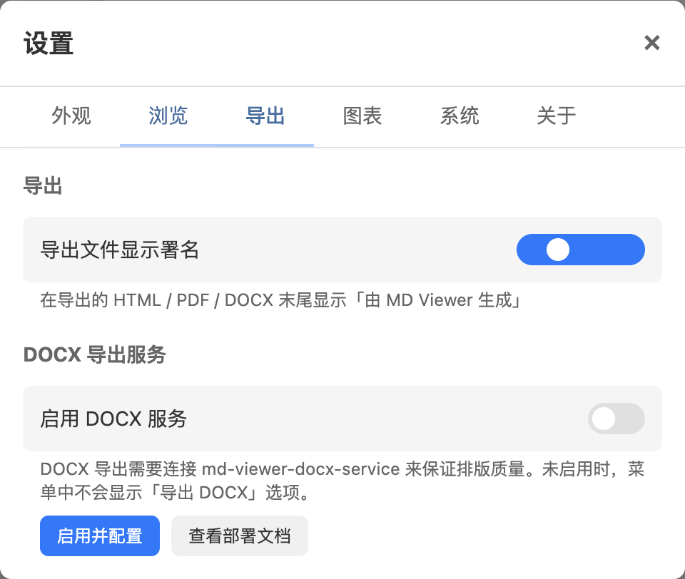

设置面板会显示连接状态、服务版本、可用样式、字体和图表渲染能力。

### 导出结果与失败处理

导出时会显示任务状态。成功后可以打开位置；如果有 warning，请查看导出详情或检查源文档中的图表。


v2.4.0 起，导出 warning 会按“发生了什么 / 影响是什么 / 下一步怎么做”展示。常见失败原因包括输出路径不可写、DOCX 服务未启动、API Key 不匹配、服务版本不兼容、字体未挂载或图表渲染失败。

DOCX 服务相关 warning 会提供“查看 DOCX 服务配置说明”入口。Docker 或远程 DOCX 服务只使用服务端可见的字体和资源；如果需要嵌入授权字体，请在服务端挂载字体目录，而不是只检查桌面端本机字体。

## 7. 阅读与窗口管理

### 分屏

分屏适合对比多个文档或一边读文档一边查看参考材料。常见入口包括标签页右键、文件树右键和分屏按钮。

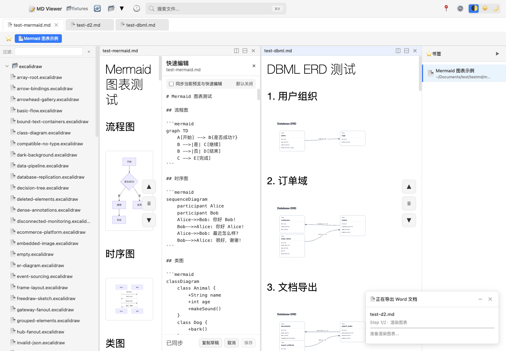

可以向右或向下分屏，并拖拽分隔线调整比例。

### 多窗口与工作区

多窗口适合同时查看不同目录或不同项目。书签等部分数据会在窗口之间同步。在文件树中右键 Markdown 文件并选择“在新窗口中打开”，可保留当前阅读窗口，同时在独立窗口打开目标文档。

每个窗口可以包含多个工作区。工作区分别保存当前文件夹、已打开文档、当前文档、分屏，以及阅读和编辑状态；切换工作区不会把这些状态混到一起。打开文件夹或最近文件夹只会替换当前工作区的目录，最近文件夹本身只是历史入口，不是仍在运行的工作区。

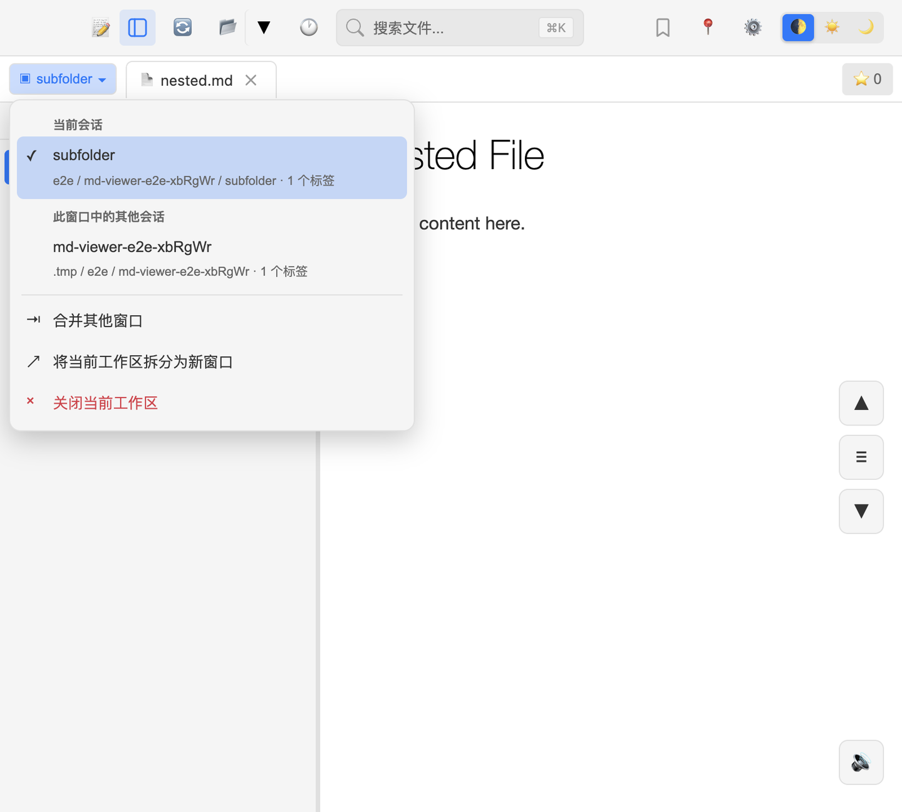

可以把当前工作区拆分到新窗口。存在其他实际打开的 MD Viewer 窗口时，当前窗口会显示“合并其他窗口”，可把所选窗口中的有效工作区整体移入当前窗口；合并完成后来源窗口会关闭。没有其他打开窗口时不会显示该入口。退出整个应用时仍然打开的窗口和有效工作区会在下次启动时恢复；单独关闭或合并关闭的窗口不会重新出现。


### 侧栏显隐

左侧文件树和右侧书签面板可分别通过各自标题栏按钮隐藏或恢复。隐藏后侧栏会完全释放宽度，适合专注阅读；显隐状态会在重启后恢复。

### 语音朗读

点击预览区的扬声器按钮可展开朗读播放条；也可以在预览正文中右键，从当前源码行对应的句子开始朗读。`Cmd/Ctrl+Shift+Space` 用于播放或暂停，首次使用快捷键会自动展开播放条。

播放条提供播放/暂停、停止、语速、朗读服务、音色、进度和睡眠定时。语速调整会立即作用于当前播放：系统声会从当前句句首按新语速重读，Edge 和付费音频会实时调整播放速率。

朗读时当前句会逐句高亮。只有当前句完全离开有效预览区域时页面才会平滑跟随；播放条覆盖的区域不计入可视范围。用户手动滚动后会暂停自动跟随，可点击“回到朗读位置”恢复。

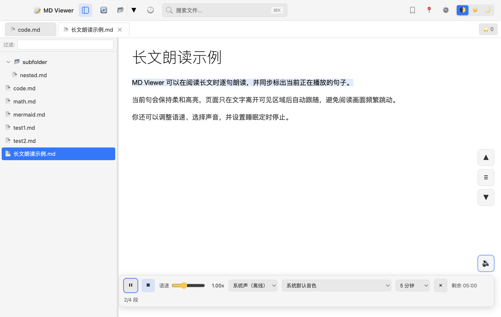

可用服务如下：

- **系统声（离线）**：使用操作系统和 Chromium 提供的本机音色，不需要联网。音色数量和名称取决于系统安装情况，可选择具体声音或使用系统默认音色。
- **Edge 免费**：内建六种中文声线。合成请求由应用主进程发起；短暂网络错误会有限重试，耗尽后可从实际失败句切换到所选系统音色，不会重复已经正常播完的上一句。
- **OpenAI 兼容 / Azure**：需要用户自行配置服务和 API Key。OpenAI 服务地址填写 API 前缀（例如 `https://example.com/v1`），应用会调用其 `/audio/speech`；同一地址和 Key 下可手动维护多个“声音方案”，每个方案以独立卡片显示方案名称、模型、音色和“当前默认”状态，适合同一模型的多个音色。模型和音色请按所用服务的文档填写，应用不会猜测非标准的模型/音色目录接口。OpenAI 兼容服务返回原始音频、JSON Base64 或 SSE Base64 时，应用会在主进程自动识别并转换为可播放音频。为避免重复计费，付费服务失败时不会自动重试。

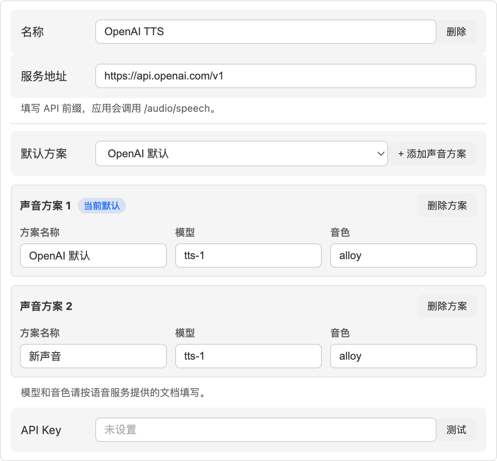

“失败时退回系统声”只处理网络或服务不可用类错误；API Key 或服务配置错误会直接提示修正配置，不会用系统声掩盖问题。关闭该选项后，联网服务失败会停止朗读。

睡眠定时可选 5、10、15 或 30 分钟，并显示剩余时间。暂停朗读不会暂停倒计时；到期会停止朗读。手动停止、切换文档、服务或音色，以及关闭当前窗口，都会取消本次定时。定时仅属于当前窗口会话，不会保存到设置或跨重启恢复。

### 全屏阅读

全屏阅读会隐藏部分界面元素，让当前文档占据更多空间。退出方式以系统全屏和应用当前提示为准。

### 字体大小

可以通过快捷键或右键菜单调整预览字体大小。常用快捷键见 [快捷键速查](#9-快捷键速查)。

### 窗口置顶

窗口置顶适合会议记录、边看边写或对照其它应用。当前快捷键帮助中显示为 `Cmd/Ctrl+Alt+T`。

### 打印

当前文档可通过打印入口打开系统打印对话框。当前快捷键帮助中显示为 `Cmd/Ctrl+P`。

### 主题设置

设置面板的“外观”页签支持浅色、深色和跟随系统主题。截图和导出样式可能与当前主题不同，导出通常会使用适合阅读的静态样式。

### 设置面板分组

v2.7.0 起，设置面板按场景拆分为“外观 / 浏览 / 导出 / 图表 / 朗读 / 系统 / 关于”。


| 页签 | 常见设置 |
| --- | --- |
| 外观 | 主题、界面外观 |
| 浏览 | 目录树全局排序、最近文件上限、文件夹历史上限、阅读相关选项 |
| 导出 | DOCX 服务、模板样式、导出相关选项 |
| 图表 | PlantUML 服务、图表能力矩阵 |
| 朗读 | 默认服务、系统/Edge 音色、默认语速、失败时退回系统声、付费服务与 API Key |
| 系统 | 右键菜单集成、命令行工具、诊断与日志 |
| 关于 | 版本、项目链接和系统信息 |

图形界面的本地诊断日志和诊断包入口位于“设置 -> 系统 -> 诊断与日志”；命令行也可通过 `doctor --bundle` 显式生成本地脱敏诊断包。

## 8. 系统集成

### macOS 右键打开

设置面板的“系统”页签提供右键菜单集成。macOS 需要安装快速操作或 Finder 扩展，并在“系统设置 -> 隐私与安全性 -> 扩展 -> Finder 扩展”中启用。

### Windows 右键打开

Windows 可通过设置面板安装 Explorer 右键菜单，用于从文件管理器中直接用 MD Viewer 打开 Markdown 文件或文件夹。

### Linux 文件关联

Linux 可通过 `.desktop` 文件或系统文件关联实现右键打开。具体行为取决于发行版和桌面环境。

### 设置面板中的右键菜单管理

设置面板的“系统”页签会显示右键菜单集成状态，并提供安装、卸载或打开系统设置等操作。卸载后如果系统仍显示灰色菜单项，请检查系统扩展或文件关联缓存。

### 设置面板中的命令行工具管理

设置面板的“系统”页签提供“命令行工具”区域。macOS、Windows 和 Linux 可在这里安装或卸载 `md-viewer` 命令；安装和卸载按钮会按当前状态互斥显示。该区域也提供“快速上手”和“使用指南”入口，适合首次配置 CLI 或交给 AI Agent 调用前查看。

### 本地诊断日志

“设置 -> 系统 -> 诊断与日志”用于记录文件夹扫描、文件读取、工作区索引和 Markdown 预览的分阶段耗时，便于复盘偶发卡顿。日志默认开启，采用 JSONL 分段文件，仅保存在当前配置的目录中；MD Viewer 不会自动上传日志或诊断包。

默认目录由 Electron 按当前系统和用户账户决定，应用界面显示的实际路径才是准确信息。典型位置如下：

- macOS：`~/Library/Logs/MD Viewer`
- Windows：`%APPDATA%\MD Viewer\logs`
- Linux：`$XDG_CONFIG_HOME/MD Viewer/logs`，未设置 XDG 时通常为 `~/.config/MD Viewer/logs`

可以通过原生目录选择器更改位置、打开日志文件夹、复制路径或恢复默认位置。自定义目录不可用时，应用会明确显示 fallback 状态，并临时写入默认位置；更换位置不会自动迁移或删除旧目录中的日志。若选择 SynologyDrive、iCloud、OneDrive、网络共享或可移除磁盘，日志可能被第三方服务同步，也可能因该目录 I/O 较慢而影响采样结果。

自动清理规则同时使用两个限制：

- 总容量：10、25 或 50 MiB；
- 保留时间：7、14 或 30 天。

默认规则为 10 MiB 和 7 天。修改两个选项后统一点击“应用规则”；如果新规则需要删除旧日志，主进程会显示一次原生确认。关闭日志只停止记录新事件，不删除已有文件。

需要协助排查时，优先点击“导出诊断包”并主动发送生成的 ZIP。诊断包固定包含系统诊断快照、README 和最近最多 10 MiB 的有效性能事件；更早记录可在日志文件夹中手动提供。导出和清除都不会处理当前日志目录以外的位置。高频且正常的索引查询会按时间窗口聚合，只保留次数和 p50/p95/max 等统计；慢查询、失败、超时、未闭合操作和 renderer 长任务仍保留异常明细，并汇总到 `diagnostics.json`。

日志和诊断包不记录 Markdown 正文、原始文件名、绝对路径、搜索词、语音文本、剪贴板内容、API Key、Bearer、TTS 密钥、媒体 capability token 或完整 URL query。路径在本机日志中使用不可逆 token 关联，导出时会再次映射为仅在该诊断包内有效的随机 token。

## 9. 快捷键速查

以当前应用的“快捷键参考”弹窗为准。

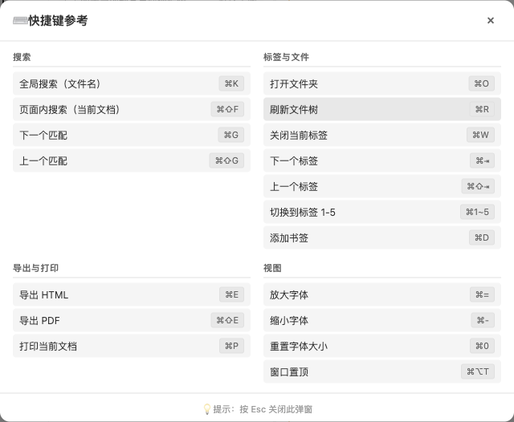

快捷键弹窗底部提供“打开使用手册”入口，可直接跳转到本文档。

| 分组 | 功能 | 快捷键 |
| --- | --- | --- |
| 搜索 | 全局搜索（文件名） | `Cmd/Ctrl+K` |
| 搜索 | 页面内搜索（当前文档） | `Cmd/Ctrl+Shift+F` |
| 搜索 | 下一个匹配 | `Cmd/Ctrl+G` |
| 搜索 | 上一个匹配 | `Cmd/Ctrl+Shift+G` |
| 标签与文件 | 打开文件夹 | `Cmd/Ctrl+O` |
| 标签与文件 | 刷新文件树 | `Cmd/Ctrl+R` |
| 标签与文件 | 关闭当前标签 | `Cmd/Ctrl+W` |
| 标签与文件 | 下一个标签 | `Cmd/Ctrl+Tab` |
| 标签与文件 | 上一个标签 | `Cmd/Ctrl+Shift+Tab` |
| 标签与文件 | 切换到标签 1-5 | `Cmd/Ctrl+1~5` |
| 标签与文件 | 添加书签 | `Cmd/Ctrl+D` |
| 导出与打印 | 导出 HTML | `Cmd/Ctrl+E` |
| 导出与打印 | 导出 PDF | `Cmd/Ctrl+Shift+E` |
| 导出与打印 | 打印当前文档 | `Cmd/Ctrl+P` |
| 朗读 | 播放或暂停朗读 | `Cmd/Ctrl+Shift+Space` |
| 视图 | 放大字体 | `Cmd/Ctrl+=` |
| 视图 | 缩小字体 | `Cmd/Ctrl+-` |
| 视图 | 重置字体大小 | `Cmd/Ctrl+0` |
| 视图 | 窗口置顶 | `Cmd/Ctrl+Alt+T` |


## 10. 命令行与自动化

MD Viewer v2.5.0 提供面向脚本和 AI Agent 的 CLI。自动化命令默认输出 JSON，生成物写入 `artifacts[]`，失败时返回 `actions[]` 说明下一步。第一次使用建议先看 [CLI 快速上手](cli-quickstart.md)；完整参数、输出契约和 AI Agent 调用建议见 [CLI 使用指南](cli.md)。

常用命令：

```bash
md-viewer capabilities --json
md-viewer schema export --json
md-viewer help export --json
md-viewer open README.md
md-viewer inspect README.md --json
md-viewer links README.md --json
md-viewer render README.md --out render.html --json
md-viewer export README.md --format pdf --out README.pdf
md-viewer export ch1.md ch2.md ch3.md --format pdf --out book.pdf
md-viewer export README.md --format docx --docx-style preview --out README.docx
md-viewer screenshot README.md --selector ".markdown-body" --out README.png
md-viewer charts list README.md --json
md-viewer charts export README.md --out-dir README-charts
md-viewer preflight README.md --format docx
md-viewer doctor --bundle diagnostics.zip --json
md-viewer diff before.md after.md --json
md-viewer watch docs --jsonl
md-viewer batch e2e/local-real-docs.json --out test-results/release-report.json --artifacts-dir test-results/cli-artifacts
```

如果还没有 `md-viewer` 命令，可以在“设置 -> 系统 -> 命令行工具”中安装，也可以用应用完整路径运行安装命令。

macOS：

```bash
"/Applications/MD Viewer.app/Contents/MacOS/MD Viewer" install-cli --json
```

Windows：

```powershell
& "C:\Program Files\MD Viewer\MD Viewer.exe" install-cli --json
```

Linux AppImage：

```bash
./MD-Viewer-*.AppImage install-cli --json
```

三类诊断命令适合脚本、CI 和 AI Agent 先判断文档质量：

- `inspect`：输出标题层级、图片、链接、代码块、图表块和资源缺失 warning，适合做文档结构摘要。
- `links`：聚焦链接健康，区分缺失 Markdown 文件、缺失锚点、缺失图片资源、外链和页内锚点。
- `render`：调用 headless renderer 做诊断渲染，返回图表数量、成功/失败数量、warning 和图表选择器；传 `--out` 时写出中间 HTML。正式交付仍使用 `export html/pdf/docx`。
- `diff`：比较 front matter、标题、段落、链接、图片、代码和图表等 Markdown 语义；`--fail-on-change` 适合 CI。
- `watch --jsonl`：只读监听 Markdown 文件或目录，每行输出一个版本化 JSON 事件；rename 是带 `inferred:true` 的提示，不会修改文件。
- `doctor --bundle`：生成不含正文、文件名、绝对路径、密钥和搜索/语音内容的本地脱敏诊断 ZIP，不上传、不发送遥测。

`inspect`、`links`、`render`、`diff` 和 `watch` 当前属于 experimental，自动化调用前请先读取 `capabilities --json`。

`batch` 支持真实文档回归配置：

```json
{
  "documents": [
    {
      "path": "e2e/fixtures/test-all-charts.md",
      "exports": ["html", "pdf", "docx"],
      "screenshots": ["page", "charts"],
      "expectCharts": true,
      "tags": ["fixture", "chart-heavy"],
      "timeoutMs": 180000
    }
  ]
}
```

建议把私有真实文档清单放在 `e2e/local-real-docs.json`，产物放在 `test-results/cli-*` 或 `/tmp`，避免提交本地路径和生成文件。DOCX 命令依赖 `md-viewer-docx-service`，导出前可先运行 `md-viewer doctor --json` 或 `md-viewer preflight README.md --format docx`。

## 11. 隐私、本地文件与外部服务

MD Viewer 主要处理本地文件。打开文件夹、预览 Markdown、HTML/PDF 导出通常在本机完成。

以下能力可能涉及外部或本地服务：

- 系统语音朗读使用本机 Web Speech API，不上传文本。
- Edge、OpenAI 兼容和 Azure 朗读会把当前待合成的文本发送到所选语音服务；第三方请求只由 Electron 主进程发起，渲染页面不直接连接语音服务。
- 付费语音服务的 API Key 使用 Electron `safeStorage` 交给系统钥匙串加密保存，不写入普通应用设置，也不会传给渲染页面；应用设置只记录该服务是否已配置 Key。
- DOCX 高质量导出会连接你配置的 `md-viewer-docx-service`。
- PlantUML 图表可能连接配置的 PlantUML 服务。
- Kroki 相关格式可能依赖当前实现配置的渲染服务。

不要在公开截图、Issue 或 Release 文档中暴露 API Key、私有文档路径、内网服务地址或业务敏感内容。

## 12. 常见问题与故障排查

### 常见问题

| 问题 | 回答 |
| --- | --- |
| 为什么默认不能直接编辑？ | MD Viewer 的核心定位是预览。进入编辑模式后才允许修改 Markdown。 |
| 什么时候需要 DOCX 服务？ | 只导出 HTML/PDF 不需要。需要高质量 Word，尤其是图表密集型文档时建议启用。 |
| 图表能否批量下载？ | 可以。在预览区右键，选择“打包下载图表”。 |
| `.excalidraw` 文件能否预览？ | 可以静态预览和导出，但不提供 Excalidraw 编辑能力。 |
| `.bpmn` 文件能否预览？ | 可以通过代码块或 Markdown 图片引用预览。 |

### 故障排查

| 现象 | 可能原因 | 处理步骤 |
| --- | --- | --- |
| 应用打不开 | macOS Gatekeeper、未拖入 `/Applications`、下载来源不可信 | 确认来自 Release，拖入 `/Applications`，必要时执行 `xattr` |
| 文件树为空 | 目录无 Markdown、权限不足、路径不可访问 | 换目录，检查权限，刷新文件树 |
| 搜索不到内容 | 搜索入口用错、过滤条件未清空、文件未被索引 | 区分全局搜索、全文搜索和页面内搜索 |
| 图片不显示 | 相对路径错误、图片文件缺失、格式不支持 | 检查 Markdown 图片路径和实际文件 |
| 图表不渲染 | 语法错误、依赖服务不可用、源码过大 | 查看源码、简化图表、检查 PlantUML/Kroki 等服务 |
| 导出失败 | 文件权限、输出路径不可写、图表渲染失败 | 换保存位置，查看错误详情 |
| DOCX 服务连接失败 | 服务未启动、地址错误、API Key 错误、版本不兼容 | 检查设置面板、服务地址和 `/readyz` |
| 保存失败 | 文件只读、外部修改冲突、权限不足 | 保留草稿，另存或处理冲突 |
| 大文件卡顿 | 文档过大、图表过多、图片过多 | 关闭不必要面板，拆分文档，减少同时渲染 |

## 13. 示例文件与进一步测试

普通安装用户无需访问源码仓库：在欢迎页选择“图表与架构图”，或打开“设置 → 图表 → 离线示例”，即可使用随应用提供的完整示例。使用步骤：

1. 点击“打开离线示例…”；
2. MD Viewer 自动校验并准备内容版本化示例目录、初始化折叠目录树、切换工作区，然后打开根目录 README；
3. 先看 21 个快速入门模板，再按主题浏览 129 个设计核心案例和 885 个专项正例。

已有完整且未经修改的同版本示例时会直接复用；如果应用管理的目录内容不同，应用会保留原内容并给出错误，不会覆盖或合并。需要分享、备份或手工处理时，可使用次要操作“仅导出 ZIP…”。

示例包与当前应用版本绑定，完整性由应用在准备或导出前校验；获取新版示例的稳定方式是升级 MD Viewer。示例内容始终留在本地，不会被更新检查自动覆盖。

源码仓库中的 `e2e/fixtures/` 仍用于开发回归，其中混有错误输入、压力测试和自动化基础设施，不应作为普通用户示例包整体分发。
